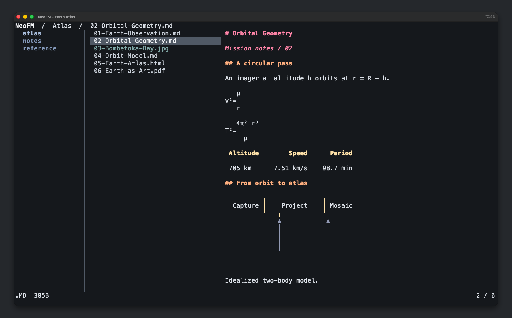

<strong>File manager moderno per terminale.</strong> Naviga come in Vim. Leggi come in un moderno visualizzatore di documenti.

[English](README.md) · [简体中文](README.zh-CN.md) · [繁體中文](README.zh-TW.md) · [日本語](README.ja.md) · [한국어](README.ko.md) · [Français](README.fr.md) · [Deutsch](README.de.md) · [Español](README.es.md) · [Português](README.pt.md) · **Italiano** · [Русский](README.ru.md)

  
  
  

---

NeoFM combina il collaudato file manager **lf** con un renderer Rust indipendente estratto dalla TUI di Codex. Offre anteprime ricche in uno spazio di lavoro leggero e orientato alla tastiera, affidando le anteprime più grandi agli strumenti di ogni piattaforma. Nessun servizio di IA, nuovo emulatore di terminale o account cloud obbligatorio.

*Premi Space per visualizzare un PDF reale nel Quick Look di macOS. NASA, Earth as Art — isole Belcher.*

## Filosofia di progettazione — meno, ma meglio

- **KISS di Unix (Keep It Simple, Stupid):** ogni componente ha una responsabilità precisa. lf gestisce navigazione e file, il renderer produce output limitato nel terminale, gli strumenti nativi gestiscono le grandi anteprime. Comporre strumenti collaudati invece di reinventarli.
- **Ispirato a [suckless](https://suckless.org/):** componenti piccoli e comprensibili, poche dipendenze, priorità alla tastiera e moderazione consapevole. NeoFM non è un progetto ufficiale di suckless.
- **Estetica per sottrazione:** niente schermata iniziale, dashboard decorativa, pulsanti superflui, browser incorporato o harness di IA. Il logo appartiene ai materiali del progetto, non allo spazio del terminale. Aggiungere solo ciò che migliora un flusso di lavoro frequente.
- **Comportamento uniforme, implementazione nativa:** stesso layout e tasti Vim su macOS, Windows e Linux, sfruttando i meccanismi di anteprima e cestino di ogni sistema. I file locali restano locali.

## Un layout, tre piattaforme

~~~text
┌────────────┬────────────────────────┬────────────────────────────────────────────────┐
│     1      │           2            │                       4                        │
│     ↑      │           →            │                       ◇                        │
└────────────┴────────────────────────┴────────────────────────────────────────────────┘
                 set ratios 1:2:4
~~~

Il rapporto predefinito è **1:2:4**: cartella superiore a sinistra, cartella corrente e selezione al centro, anteprima in tempo reale a destra. Il contenuto riceve lo spazio maggiore, senza editor separato o barra degli strumenti permanente. Gli elementi nascosti sono visibili per impostazione predefinita; zh alterna la visualizzazione. I launcher controllano il layout senza introdurre un nuovo framework di interfaccia per terminale.

| Contenuto | Anteprima in tempo reale | Space — anteprima grande |
|:--|:--|:--|
| Markdown | Titoli, elenchi, tabelle adattive, CJK, evidenziazione del codice, formule, Mermaid | Visualizzatore nativo compatibile |
| Immagini | PNG, JPEG, primo fotogramma GIF, WebP; Sixel o ANSI | Visualizzatore esterno a dimensione maggiore |
| Testo / codice | Rendering di testo limitato | Visualizzatore nativo / lettore terminale |
| PDF, Office, media | Metadati e indicazione di anteprima | Dipende dai formati supportati dall'app esterna |

## Anteprime ricche via SSH — senza desktop

NeoFM è anche un browser remoto di documenti. Eseguilo su un server Linux tramite SSH normale: navigazione, operazioni sui file e gran parte delle anteprime laterali quotidiane restano disponibili senza inoltro X11, desktop remoto o download. Il renderer gira sull'host remoto e il terminale ne mostra l'output.

| Formato | Anteprima laterale via SSH |
| :-- | :-- |
| Markdown: titoli, elenchi, tabelle, CJK, blocchi di codice, formule, Mermaid | Rendering ricco |
| Testo UTF-8, sorgenti, JSON, log, sorgente HTML | Anteprima testuale |
| PNG, JPEG, primo fotogramma GIF, WebP | Sixel o blocchi ANSI entro i limiti |
| PDF, Office, media e archivi | Tipo/dimensione o metadati binari, non rendering completo |

Su Linux via SSH o headless, Space apre il lettore terminale (less -R -X se disponibile): Markdown renderizzato, testo limitato o metadati. Le immagini sono renderizzate nella colonna laterale, non ingrandite nel lettore. PDF/Office completi, HTML renderizzato e Quick Look multimediale richiedono un visualizzatore grafico locale adatto. macOS e Windows conservano le proprie assegnazioni Space; il lettore SSH automatico qui descritto è quello Linux. Il rilevamento dipende dal terminale e dall'ambiente inoltrato; tmux/screen usano ANSI. Forza Sixel solo su terminali compatibili. L'output è limitato; la fedeltà visiva SSH ad alta risoluzione non è completamente verificata.

Verificato tramite una vera connessione SSH a Linux: Markdown, formule/Mermaid, generazione frame Sixel, immagini ANSI e percorso lettore terminale (vedi validazione). [↗](docs/validation.md#ssh-preview-verification)

~~~sh
ssh user@linux-server
neofm
# Optional: reliable color-block preview in any compatible color terminal
LFP_IMAGE_BACKEND=ansi neofm
~~~

## NeoFM in azione

*Anteprima Markdown — titoli, elenchi e tabelle adattive.*

*Matematica e Mermaid — frazioni impaginate e diagrammi nel terminale.*

*Quick Look HTML — una pagina HTML locale nella finestra nativa.*

*Immagini Sixel — grafica reale nel terminale, limitata dal budget di pixel del renderer.*

*Codice Markdown — evidenziazione di un blocco Python, non di un file sorgente autonomo.*

Acquisizioni reali su macOS; Graphite / Menlo. Crediti NASA: [Note sulle immagini e crediti](docs/gallery.md).

## Configurazione completa consigliata

| Piattaforma | Terminale / desktop | Space | Cestino |
|:--|:--|:--|:--|
| macOS ARM64 | [iTerm2](https://iterm2.com/) (Sixel) o Terminal (ANSI) | Quick Look integrato | Cestino di sistema |
| Windows x64 | [Windows Terminal](https://github.com/microsoft/terminal) recente con Sixel; PowerShell o CMD | [QL-Win QuickLook](https://github.com/QL-Win/QuickLook), installazione separata | Cestino Windows |
| Linux x64 desktop | [DWM](https://dwm.suckless.org/) / [st](https://st.suckless.org/) o altro terminale; Sixel per immagini raster | [Dzurkel](https://github.com/EdinUser/dzurkel) | gio / trash-put |
| Linux headless / SSH | Terminale esistente; less consigliato | Testo / metadati | gio / trash-put |

Sono combinazioni consigliate, non ambienti obbligatori. Il nucleo non dipende da Qt. Senza Sixel o con tmux/screen si usa ANSI. LFP_IMAGE_BACKEND accetta auto, ansi, sixel e none; forzare sixel solo su terminali compatibili.

## Compilazione e avvio

Servono Go 1.26+ e Rust/Cargo 1.94+ sulla piattaforma di destinazione; Windows richiede anche gli strumenti MSVC. La prima compilazione scarica le dipendenze bloccate. È un repository privato di sviluppo, non un pacchetto pubblico; clonarlo richiede accesso autorizzato a GitHub.

### macOS / Linux

~~~sh
git clone https://github.com/lannyyuan/NeoFM.git
cd NeoFM
./scripts/build.sh

# macOS / Apple Silicon
./dist/neofm-macos-arm64/bin/neofm

# Linux / x86_64
./dist/neofm-linux-x64/bin/neofm
~~~

Usa il launcher, non lf direttamente. Per un comando locale, collega bin/neofm della build scelta in ~/.local/bin senza sovrascrivere un ingresso esistente. Mantieni terminale e gestore di finestre.

**macOS:** non serve un'app Quick Look aggiuntiva. Il launcher usa /usr/bin/qlmanage -p; iTerm2 è consigliato per Sixel, Terminal può usare ANSI.

~~~sh
# Optional: prefer Sixel only in a compatible terminal
LFP_IMAGE_BACKEND=auto ./dist/neofm-macos-arm64/bin/neofm
# Inspect the native preview command
command -v qlmanage
~~~

**Linux:** installa separatamente Dzurkel e dipendenze Qt compatibili. ANSI funziona anche con DWM/st senza Sixel. Verifica gli strumenti seguenti e installa quelli mancanti tramite il gestore dei pacchetti. Dzurkel viene usato solo in sessioni grafiche locali; SSH normale usa il fallback nel terminale. Se Qt è incompatibile, configura un runtime Dzurkel compatibile e isolato invece di aggiornare l'intero desktop.

~~~sh
command -v dzurkel
command -v gio || command -v trash-put
command -v less
command -v xdg-open
~~~

### Windows — configurazione completa

Installa Windows Terminal compatibile con Sixel, [QuickLook](https://github.com/QL-Win/QuickLook) e gli strumenti di compilazione nativi indicati. QuickLook è un'app di terze parti, non una funzione integrata in Windows. Avviala una volta nella sessione desktop dopo l'installazione, quindi compila NeoFM.

~~~powershell
git clone https://github.com/lannyyuan/NeoFM.git
cd NeoFM
powershell -ExecutionPolicy Bypass -File .\scripts\build.ps1
.\dist\NeoFM-win-x64\neofm.exe
~~~

**Configurare QuickLook:** il percorso predefinito è %LOCALAPPDATA%\Programs\QuickLook\QuickLook.exe. Altri metodi di installazione possono usare percorsi differenti. In PowerShell imposta e verifica il percorso completo dell'EXE, sostituendolo se necessario.

~~~powershell
$env:LFP_QUICKLOOK_EXE = Join-Path $env:LOCALAPPDATA "Programs\QuickLook\QuickLook.exe"
Test-Path -LiteralPath $env:LFP_QUICKLOOK_EXE
# If False, replace the value with the actual full EXE path.
# Optional direct QuickLook test from the repository root (uncomment):
# & $env:LFP_QUICKLOOK_EXE (Resolve-Path ".\dist\NeoFM-win-x64\samples\fixtures-quicklook\01 sample 中文.pdf").Path
# Run from the NeoFM repository root:
.\dist\NeoFM-win-x64\neofm.exe
~~~

Equivalente in CMD:

~~~bat
set "LFP_QUICKLOOK_EXE=%LOCALAPPDATA%\Programs\QuickLook\QuickLook.exe"
if exist "%LFP_QUICKLOOK_EXE%" echo QuickLook OK
where cmd.exe
.\dist\NeoFM-win-x64\neofm.exe
~~~

**Importante:** avvia sempre neofm.exe, non lf.exe. Il launcher completa System32, ComSpec e PATHEXT nel proprio processo, senza modificare il PATH globale. La shell interna di lf resta CMD anche avviando da PowerShell 5.1 o 7.x. Se Space marca un file invece di mostrarlo, il lfrc personalizzato potrebbe non essere stato caricato. Se appare 'exec: "cmd": executable file not found in %PATH%', riavvia tramite il launcher e verifica System32. Apri prima un PDF di prova direttamente con QuickLook, poi prova Space sullo stesso file. Registro diagnostico e fallback ANSI:

~~~powershell
Get-Content "$env:LOCALAPPDATA\LFpreview\data\lfwin.log" -Tail 30
$env:LFP_IMAGE_BACKEND = "ansi"
.\dist\NeoFM-win-x64\neofm.exe
~~~

dd usa Windows PowerShell 5.1 e l'API Shell nativa; provalo con un file sacrificabile su un'unità fissa locale. Plugin di formati, codec e fedeltà grafica del terminale sono separati dal nucleo. Il percorso generalizzato richiede ancora un test di regressione GUI completo.

## Tasti

### Navigazione e anteprima

| Tasto | Azione |
| :-- | :-- |
| `↑ / k · ↓ / j` | Su/giù |
| `← / h` | Cartella superiore |
| `→ / l · Enter` | Entra nella cartella; alterna marca file |
| `Home / gg · End / G` | Primo/ultimo |
| `Ctrl+U / Ctrl+D` | Mezza pagina su/giù |
| `PageUp / Ctrl+B · PageDown / Ctrl+F` | Pagina su/giù |
| `Ctrl+Y / Ctrl+E` | Scorri una riga su/giù |
| `H / M / L` | Parte alta/centrale/bassa dello schermo |
| `gh` | Cartella home |
| `[ / ]` | Cartella precedente/successiva nella cronologia |
| `Space` | Anteprima grande / lettore terminale |
| `o` | Apri esternamente |

### Selezione e file

| Tasto | Azione |
| :-- | :-- |
| `Ctrl+Space` | Alterna marcatura corrente |
| `u` | Deseleziona tutto in tutte le cartelle |
| `v` | Inverti selezione della cartella corrente |
| `V` | Inizia selezione intervallo |
| `yy` | Copia nel buffer NeoFM |
| `x` | Taglia nel buffer NeoFM |
| `p` | Incolla nella cartella corrente |
| `c` | Svuota buffer file |
| `dd` | Conferma e sposta nel cestino |
| `r` | Rinomina |
| `t` | Alterna tag file |

### Ricerca e cronologia

| Tasto | Azione |
| :-- | :-- |
| `/ / ?` | Cerca nome avanti/indietro |
| `n / N` | Risultato successivo/precedente |
| `f / F` | Ricerca rapida avanti/indietro |
| `; / ,` | Corrispondenza rapida successiva/precedente |
| `m / ' / "` | Salva/carica/rimuovi segnalibro cartella |

### Ordinamento e visualizzazione

| Tasto | Azione |
| :-- | :-- |
| `zh` | Alterna elementi nascosti |
| `zr` | Inverti ordinamento |
| `zn / zs / zt / za` | Nascondi info / dimensione / data / entrambe |
| `sn / ss / st` | Ordina per nome / dimensione / modifica |
| `sa / sb / sc / se` | Ordina per accesso / creazione / cambio stato / estensione |
| `Ctrl+L / Ctrl+R` | Ridisegna / ricarica |

### Comandi e modalità

| Tasto | Azione |
| :-- | :-- |
| `:` | Inserimento comandi |
| `$ / % / ! / &` | Shell / pipe / attesa / asincrona |
| `Ctrl+P / Ctrl+N` | Comando precedente/successivo |
| `q` | Esci |

Tasti predefiniti in modalità normale, con distinzione maiuscole/minuscole. Marca più file con Enter o Ctrl+Space, premi yy (copia) o x (taglia), vai alla destinazione e premi p. Senza marcature viene usato il file corrente. Copia/taglia cancella le marche ma conserva il buffer interno; u toglie marche, c svuota il buffer. yy e dd sono due pressioni consecutive. dd chiede conferma e usa eliminazione recuperabile, senza passare deliberatamente a cancellazione definitiva. Space e o dipendono dalla piattaforma e sessione.

Modalità visuale: V inizia un intervallo, spostati per estenderlo, V accetta, Esc scarta, o scambia gli estremi. y/d ereditati restano in modalità visuale, distinti da yy/x in normale. Accetta con V poi usa yy/x/dd in normale. Riga di comando: Enter esegue, Esc annulla, Tab completa, frecce su/giù per cronologia, sinistra/destra e Home/End per cursore. Per tutti i tasti di editing ereditati e comandi, esegui neofm -doc o consulta [lf documentation](lf-upstream/doc.txt).

Le associazioni della rotella sono ereditate, ma il mouse è disattivato per impostazione predefinita.

## Architettura e validazione

~~~text
                  NeoFM launcher
                        │
                   lf (Go)
             ┌──────────┴───────────┐
             │                      │
    neofm-preview (Rust)               Space
       ┌─────┴─────┐                │
   Markdown      Images       Native preview
   Math/Mermaid  Sixel/ANSI   / terminal fallback
~~~

Un albero di sorgenti condiviso, launcher specifici per piattaforma. Vedi [architettura](docs/architecture.md), [validazione](docs/validation.md) e [provenienza](UPSTREAM.md).

~~~sh
cargo test --locked --manifest-path lf-integration-poc/adapter/Cargo.toml
~~~

Le build native Rust Release unificate sono riuscite su Mac ARM64, Windows x64 e Linux x64, con quattro test di base del renderer per piattaforma; adapter Mac 19/19. I precedenti deployment hanno provato anteprime native e cestino. Il Writer adattato conserva tre errori noti in test derivati dall'upstream. Non si rivendicano parità completa con upstream, ripetizione integrale dei test GUI, schede interattive né rendering completo PDF/Office o grafica ad alta risoluzione via SSH headless.

## Crediti e licenza

Basato su [lf](https://github.com/gokcehan/lf) (MIT) e componenti estratti da [OpenAI Codex](https://github.com/openai/codex) (Apache-2.0). QuickLook e Dzurkel si installano separatamente, non sono inclusi. NeoFM è indipendente. Vedi [LICENSE](LICENSE), [NOTICE](NOTICE), [licenza lf](lf-upstream/LICENSE), [UPSTREAM.md](UPSTREAM.md) e [risorse del marchio](assets/brand/).

Piccoli strumenti. File chiari. Anteprime native.

