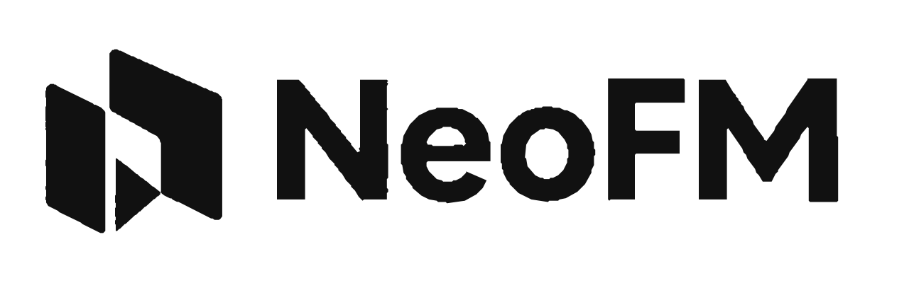

  <picture>
    <source media="(prefers-color-scheme: dark)" srcset="assets/brand/png/neofm-horizontal-white.png">
    
  </picture>

<strong>현대적인 터미널 파일 관리자</strong> Vim처럼 탐색하고, 현대적인 문서 뷰어처럼 읽으세요.

[English](README.md) · [简体中文](README.zh-CN.md) · [繁體中文](README.zh-TW.md) · [日本語](README.ja.md) · **한국어** · [Français](README.fr.md) · [Deutsch](README.de.md) · [Español](README.es.md) · [Português](README.pt.md) · [Italiano](README.it.md) · [Русский](README.ru.md)

  
  
  

---

NeoFM은 검증된 **lf** 파일 관리자와 Codex TUI에서 추출한 독립 Rust 렌더러를 결합하여 가볍고 키보드 중심인 터미널 작업 공간에 풍부한 문서 미리보기를 제공합니다. 큰 미리보기는 각 플랫폼의 기존 도구에 맡깁니다. AI 서비스, 새로운 터미널 에뮬레이터, 필수 클라우드 계정은 필요하지 않습니다.

## 설계 철학 — 더 적게, 더 좋게

- **Unix KISS(Keep It Simple, Stupid):** 각 구성 요소의 책임을 제한합니다. lf는 탐색과 파일 작업, 렌더러는 범위가 제한된 터미널 출력, 네이티브 도구는 큰 미리보기를 담당합니다. 검증된 도구를 조합하고 같은 기능을 다시 만들지 않습니다.
- **[suckless](https://suckless.org/) 철학에서 영감:** 작고 이해하기 쉬운 구성 요소, 적은 의존성, 키보드 우선, 의도적인 절제. NeoFM은 suckless 공식 프로젝트가 아닙니다.
- **덜어내는 디자인:** 시작 화면, 장식용 대시보드, 불필요한 버튼, 내장 브라우저 또는 AI Harness를 추가하지 않습니다. 로고는 프로젝트 자료에만 사용하고 터미널 작업 공간을 차지하지 않습니다. 자주 사용하는 작업 흐름을 개선할 때만 기능을 추가합니다.
- **일관된 동작, 네이티브 구현:** macOS, Windows, Linux에서 동일한 레이아웃과 Vim 키맵을 사용하며 각 OS의 성숙한 미리보기 및 휴지통을 활용합니다. 로컬 파일은 로컬에 남습니다.

## 하나의 레이아웃, 세 플랫폼

~~~text
┌────────────┬────────────────────────┬────────────────────────────────────────────────┐
│     1      │           2            │                       4                        │
│     ↑      │           →            │                       ◇                        │
└────────────┴────────────────────────┴────────────────────────────────────────────────┘
                 set ratios 1:2:4
~~~

기본 비율은 **1:2:4**입니다. 왼쪽은 상위 디렉터리, 가운데는 현재 디렉터리와 선택 항목, 오른쪽은 실시간 미리보기입니다. 콘텐츠에 가장 넓은 공간을 할당하고 별도 편집기나 상시 도구 모음을 두지 않습니다. 숨김 항목은 기본 표시되며 zh로 전환합니다. 각 플랫폼의 실행기가 레이아웃을 제어하며 새 터미널 UI 프레임워크를 도입하지 않습니다.

| 내용 | 실시간 미리보기 | Space — 큰 미리보기 |
|:--|:--|:--|
| Markdown | 제목, 목록, 적응형 표, CJK, 코드 강조, 수식, Mermaid | 지원되는 네이티브 뷰어 |
| 이미지 | PNG, JPEG, GIF 첫 프레임, WebP; Sixel 또는 ANSI | 외부 전체 크기 뷰어 |
| 텍스트 / 코드 | 제한된 텍스트 렌더링 | 네이티브 뷰어 / 터미널 리더 |
| PDF, Office, 미디어 | 메타데이터와 미리보기 안내 | 외부 앱의 형식 지원에 따름 |

## 권장 전체 기능 구성

| 플랫폼 | 터미널 / 데스크톱 | Space | 휴지통 |
|:--|:--|:--|:--|
| macOS ARM64 | [iTerm2](https://iterm2.com/)(Sixel) 또는 Terminal(ANSI) | 내장 Quick Look | 시스템 휴지통 |
| Windows x64 | Sixel 지원 최신 [Windows Terminal](https://github.com/microsoft/terminal); PowerShell 또는 CMD | 별도 설치 [QL-Win QuickLook](https://github.com/QL-Win/QuickLook) | Windows 휴지통 |
| Linux x64 데스크톱 | [DWM](https://dwm.suckless.org/) / [st](https://st.suckless.org/) 또는 다른 터미널; 래스터 그래픽에는 Sixel 지원 터미널 | [Dzurkel](https://github.com/EdinUser/dzurkel) | gio / trash-put |
| Linux 헤드리스 / SSH | 기존 터미널; less 권장 | 텍스트 / 메타데이터 | gio / trash-put |

권장 조합이며 특정 데스크톱 환경이 필수는 아닙니다. 코어는 Qt에 의존하지 않습니다. Sixel 미지원 터미널 또는 tmux/screen에서는 ANSI로 대체합니다. LFP_IMAGE_BACKEND는 auto, ansi, sixel, none을 지원하며 호환 터미널에서만 sixel을 강제하십시오.

## 빌드 및 실행

대상 플랫폼에 Go 1.26+, Rust/Cargo 1.94+가 필요하며 Windows는 MSVC 빌드 도구도 필요합니다. 첫 빌드에서 잠긴 버전의 의존성을 다운로드합니다. 비공개 개발 저장소이며 공개 패키지가 아니므로 복제하려면 승인된 GitHub 접근 권한이 필요합니다.

### macOS / Linux

~~~sh
git clone https://github.com/lannyyuan/NeoFM.git
cd NeoFM
./scripts/build.sh

# macOS / Apple Silicon
./dist/neofm-macos-arm64/bin/neofm

# Linux / x86_64
./dist/neofm-linux-x64/bin/neofm
~~~

lf를 직접 실행하지 말고 실행기를 사용합니다. 사용자 수준 명령이 필요하면 기존 항목을 덮어쓰지 않고 해당 빌드의 bin/neofm을 ~/.local/bin에 연결합니다. 기존 터미널과 창 관리자를 유지합니다.

**macOS:** 별도 Quick Look 앱이 필요 없습니다. 실행기는 /usr/bin/qlmanage -p를 호출합니다. Sixel에는 iTerm2를 권장하고 시스템 Terminal은 ANSI를 사용할 수 있습니다.

~~~sh
# Optional: prefer Sixel only in a compatible terminal
LFP_IMAGE_BACKEND=auto ./dist/neofm-macos-arm64/bin/neofm
# Inspect the native preview command
command -v qlmanage
~~~

**Linux:** 그래픽 미리보기를 위해 Dzurkel과 호환 Qt 의존성을 별도로 설치합니다. Sixel이 없는 DWM/st에서도 ANSI가 작동합니다. 다음 도구를 확인하고 누락된 도구는 배포판 패키지 관리자로 설치합니다. 로컬 그래픽 세션에서만 Dzurkel을 사용하고 일반 SSH에서는 터미널로 대체합니다. Qt 버전 충돌이 있다면 NeoFM 때문에 전체 데스크톱을 업그레이드하는 대신 호환되는 격리 Dzurkel 런타임을 구성합니다.

~~~sh
command -v dzurkel
command -v gio || command -v trash-put
command -v less
command -v xdg-open
~~~

### Windows — 전체 구성

Sixel을 지원하는 Windows Terminal, [QuickLook](https://github.com/QL-Win/QuickLook), 위의 네이티브 빌드 도구를 설치합니다. QuickLook은 Windows 내장 기능이 아닌 타사 앱입니다. 설치 후 데스크톱 세션에서 한 번 실행한 다음 NeoFM을 빌드합니다.

~~~powershell
git clone https://github.com/lannyyuan/NeoFM.git
cd NeoFM
powershell -ExecutionPolicy Bypass -File .\scripts\build.ps1
.\dist\NeoFM-win-x64\neofm.cmd
~~~

**QuickLook 설정:** 기본 경로는 %LOCALAPPDATA%\Programs\QuickLook\QuickLook.exe입니다. 설치 방법에 따라 다를 수 있습니다. PowerShell에서 EXE 전체 경로를 설정하고 확인하며 필요하면 실제 경로로 바꿉니다.

~~~powershell
$env:LFP_QUICKLOOK_EXE = Join-Path $env:LOCALAPPDATA "Programs\QuickLook\QuickLook.exe"
Test-Path -LiteralPath $env:LFP_QUICKLOOK_EXE
# If False, replace the value with the actual full EXE path.
# Optional direct QuickLook test from the repository root (uncomment):
# & $env:LFP_QUICKLOOK_EXE (Resolve-Path ".\dist\NeoFM-win-x64\samples\fixtures-quicklook\01 sample 中文.pdf").Path
# Run from the NeoFM repository root:
.\dist\NeoFM-win-x64\neofm.cmd
~~~

CMD에서의 방법:

~~~bat
set "LFP_QUICKLOOK_EXE=%LOCALAPPDATA%\Programs\QuickLook\QuickLook.exe"
if exist "%LFP_QUICKLOOK_EXE%" echo QuickLook OK
where cmd.exe
.\dist\NeoFM-win-x64\neofm.cmd
~~~

**중요:** lf.exe가 아니라 항상 neofm.cmd로 실행합니다. 실행기는 자체 프로세스에서 System32, ComSpec, PATHEXT를 보완하고 전역 PATH를 변경하지 않습니다. PowerShell 5.1 또는 7.x에서 시작해도 lf 내부 셸은 CMD입니다. Space가 미리보기 대신 표시를 토글하면 사용자 정의 lfrc가 로드되지 않았을 수 있습니다. 'exec: "cmd": executable file not found in %PATH%'가 나오면 실행기로 다시 시작하고 System32를 확인합니다. 먼저 테스트 PDF를 QuickLook으로 직접 연 뒤 같은 파일에서 Space를 시험합니다. 진단 로그와 ANSI 대체:

~~~powershell
Get-Content "$env:LOCALAPPDATA\LFpreview\data\lfwin.log" -Tail 30
$env:LFP_IMAGE_BACKEND = "ansi"
.\dist\NeoFM-win-x64\neofm.cmd
~~~

dd는 Windows PowerShell 5.1과 네이티브 Shell API를 사용합니다. 로컬 고정 드라이브의 일회용 파일로 확인합니다. QuickLook 형식 플러그인, 코덱 및 터미널 화질은 코어와 별개입니다. 일반화된 경로는 아직 전체 GUI 회귀 시험이 필요합니다.

## 키맵

| 키 | 동작 | 키 | 동작 |
|:--|:--|:--|:--|
| `h / j / k / l` | 탐색 | `Space` | Quick Look |
| `Enter` | 파일 표시 전환 / 폴더 진입 | `Ctrl+Space` | 표시 전환 |
| `yy` | 복사 | `p` | 붙여넣기 |
| `x` | 잘라내기 | `dd` | 확인 후 휴지통 |
| `o` | 외부 앱 열기 | `zh` | 숨김 항목 전환 |
| `gg / G` | 처음 / 마지막 | `/` | 검색 |
| `r` | 이름 변경 | `q` | 종료 |

표시된 파일이 우선이며 없으면 현재 파일을 대상으로 합니다. dd는 확인을 요구하고 네이티브 휴지통을 사용할 수 없을 때 의도적으로 영구 삭제로 대체하지 않습니다.

## 아키텍처 및 검증

~~~text
                  NeoFM launcher
                        │
                   lf (Go)
             ┌──────────┴───────────┐
             │                      │
    lfpreview (Rust)               Space
       ┌─────┴─────┐                │
   Markdown      Images       Native preview
   Math/Mermaid  Sixel/ANSI   / terminal fallback
~~~

하나의 공유 소스 트리와 플랫폼별 실행기. [아키텍처](docs/architecture.md), [검증](docs/validation.md), [업스트림 출처](UPSTREAM.md)를 참조하십시오.

~~~sh
cargo test --locked --manifest-path lf-integration-poc/adapter/Cargo.toml
~~~

통합 Rust Release는 Mac ARM64, Windows x64, Linux x64에서 네이티브 빌드와 각 4개 렌더러 스모크 테스트를 통과했습니다. Mac Adapter는 19/19입니다. 이전 배포에서 실제 플랫폼의 미리보기와 휴지통도 시험했습니다. 적응된 Writer에는 알려진 업스트림 파생 실패 3건이 남아 있습니다. 전체 업스트림 일치, 전체 GUI 재시험, 대화형 Sidebar Tabs, 헤드리스 SSH에서 완전한 PDF/Office 및 고해상도 그래픽을 주장하지 않습니다.

## 감사 및 라이선스

[lf](https://github.com/gokcehan/lf)(MIT)와 [OpenAI Codex](https://github.com/openai/codex)(Apache-2.0)의 추출 구성 요소를 사용합니다. QuickLook과 Dzurkel은 별도 설치이며 포함되지 않습니다. NeoFM은 독립 프로젝트입니다. [LICENSE](LICENSE), [NOTICE](NOTICE), [lf 라이선스](lf-upstream/LICENSE), [UPSTREAM.md](UPSTREAM.md), [브랜드 리소스](assets/brand/)를 참조하십시오.

작은 도구, 명확한 파일, 네이티브 미리보기.

