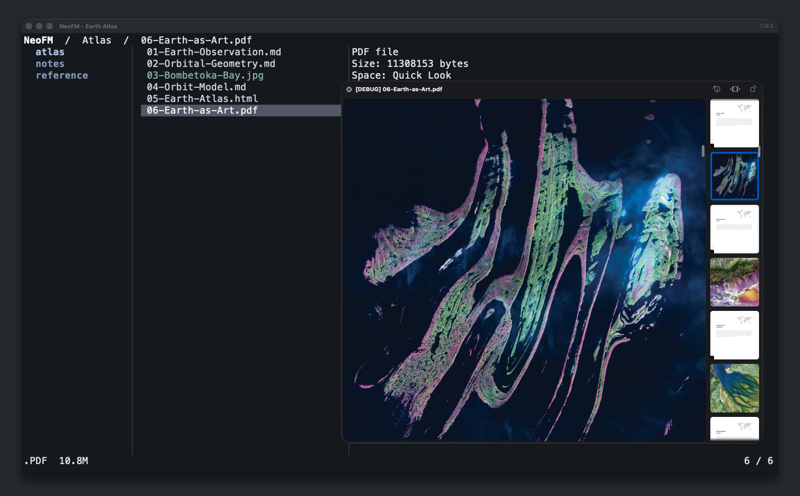

<strong>Modern terminal file manager.</strong> Navigate like Vim. Read like a modern document viewer.

**English** · [简体中文](README.zh-CN.md) · [繁體中文](README.zh-TW.md) · [日本語](README.ja.md) · [한국어](README.ko.md) · [Français](README.fr.md) · [Deutsch](README.de.md) · [Español](README.es.md) · [Português](README.pt.md) · [Italiano](README.it.md) · [Русский](README.ru.md)

  
  
  

---

NeoFM brings rich document previews to a lightweight, keyboard-first terminal workspace. It combines the proven **lf** file manager with a standalone Rust renderer extracted from the Codex TUI, and delegates larger previews to the platform's own tools. No AI service, new terminal emulator, or mandatory cloud account.

*Press Space to preview a real PDF in macOS Quick Look. NASA Earth as Art — Belcher Islands.*

## Design philosophy — less, but better

- **Unix KISS (Keep It Simple, Stupid):** keep each component focused. lf handles navigation and file operations; the renderer produces bounded terminal output; native tools handle larger previews. Compose working tools instead of rebuilding them.
- **Inspired by [suckless](https://suckless.org/):** small, understandable components, few dependencies, keyboard-first operation and deliberate restraint. NeoFM is inspired by the philosophy, not an official suckless project.
- **Taste through subtraction:** no splash screen, decorative dashboard, unnecessary buttons, embedded browser or AI harness. Keep the logo in project materials, not in the terminal workspace. Add a feature only when it improves a frequent workflow.
- **Consistent behavior, native implementation:** the same layout and Vim keymap on macOS, Windows and Linux; use the mature preview and Trash mechanisms of each OS. Local files stay local.

## One layout, three platforms

~~~text
┌────────────┬────────────────────────┬────────────────────────────────────────────────┐
│     1      │           2            │                       4                        │
│     ↑      │           →            │                       ◇                        │
└────────────┴────────────────────────┴────────────────────────────────────────────────┘
                 set ratios 1:2:4
~~~

The default ratio is **1:2:4**: parent directory (left), current directory and selection (center), live preview (right). The preview gets the largest share; no separate editor or permanently occupied toolbar. Hidden entries are visible by default; use zh to toggle them. The layout is controlled by the platform launchers, not a new terminal UI framework.

| Content | Live sidebar | Space — large preview |
|:--|:--|:--|
| Markdown | Headings, lists, adaptive tables, CJK, highlighted code, math, Mermaid | Native viewer where supported |
| Images | PNG, JPEG, GIF first frame, WebP; Sixel or ANSI | External full-size viewer |
| Text / code | Bounded text rendering | Native viewer / terminal reader |
| PDF, Office, media | Metadata and preview hint | Format support depends on external app |

## Rich previews over SSH — no desktop required

NeoFM is a remote document browser as well as a local file manager. Run it on a Linux server over ordinary SSH: navigation, file operations and most everyday sidebar preview workflows remain available without X11 forwarding, a remote desktop, or downloading files to your workstation. The renderer runs on the remote host; the terminal displays its output.

| Format | Live sidebar over SSH |
| :-- | :-- |
| Markdown: headings, lists, tables, CJK, code blocks, math and Mermaid | Rich rendering |
| UTF-8 text, source, JSON, logs, HTML source | Text preview |
| PNG, JPEG, GIF first frame, WebP | Sixel or ANSI color blocks, within rendering limits |
| PDF, Office, media and archives | Type/size or binary metadata; not full document/media rendering |

On Linux SSH or headless sessions, Space opens the terminal reading fallback (less -R -X when available): rendered Markdown, bounded text or metadata. Images are rendered in the sidebar; the pager does not provide an enlarged graphical image. Full PDF/Office, rendered HTML and multimedia Quick Look require an appropriate local GUI viewer. macOS and Windows currently retain their platform-specific Space bindings; the automatic SSH reader described here is the Linux route. Image auto-detection depends on terminal capabilities and forwarded environment; tmux/screen use ANSI. Force Sixel only with a compatible terminal. The output is bounded; high-resolution SSH display fidelity has not been fully visually validated.

Verified over an actual SSH connection to Linux: Markdown, math/Mermaid, Sixel frame generation, ANSI images and terminal-reader routing (see validation). [↗](docs/validation.md#ssh-preview-verification)

~~~sh
ssh user@linux-server
neofm
# Optional: reliable color-block preview in any compatible color terminal
LFP_IMAGE_BACKEND=ansi neofm
~~~

## See NeoFM in action

*Live Markdown — formatted headings, lists and adaptive tables.*

*Math & Mermaid — stacked fractions and terminal flowcharts.*

*HTML Quick Look — a local HTML page in the native preview window.*

*Sixel images — actual terminal graphics, subject to the renderer's pixel budget.*

*Markdown code — syntax-highlighted Python fenced code, not standalone source highlighting.*

Actual macOS captures; Graphite / Menlo. NASA imagery credited in [Capture notes & image credits](docs/gallery.md).

## Recommended complete setup

| Platform | Terminal / desktop | Space | Trash |
|:--|:--|:--|:--|
| macOS ARM64 | [iTerm2](https://iterm2.com/) (Sixel) or Terminal (ANSI) | Built-in Quick Look | System trash |
| Windows x64 | Recent Sixel-capable [Windows Terminal](https://github.com/microsoft/terminal); PowerShell or CMD | [QL-Win QuickLook](https://github.com/QL-Win/QuickLook), separately installed | Windows Recycle Bin |
| Linux x64 desktop | [DWM](https://dwm.suckless.org/) / [st](https://st.suckless.org/) or another terminal; Sixel-capable terminal for raster graphics | [Dzurkel](https://github.com/EdinUser/dzurkel) | gio / trash-put |
| Linux headless / SSH | Existing terminal; less recommended | Terminal text/metadata | gio / trash-put |

These are recommended combinations, not mandatory desktop environments. The core requires no Qt. On terminals without Sixel, or in tmux/screen, use ANSI fallback. Choose LFP_IMAGE_BACKEND=auto, ansi, sixel or none; only force sixel on a compatible terminal.

## Build and run

Use Go 1.26+ and Rust/Cargo 1.94+ on the target platform; Windows also requires MSVC build tools. The first build downloads locked dependencies. Prebuilt packages are available from [GitHub Releases](https://github.com/lannyyuan/NeoFM/releases/latest); the source repository is public.

### macOS / Linux

~~~sh
git clone https://github.com/lannyyuan/NeoFM.git
cd NeoFM
./scripts/build.sh

# macOS / Apple Silicon
./dist/neofm-macos-arm64/bin/neofm

# Linux / x86_64
./dist/neofm-linux-x64/bin/neofm
~~~

Use the launchers, not bare lf. To create a user-local command, link the chosen build's bin/neofm into ~/.local/bin without overwriting an existing entry. Keep the existing terminal and window manager.

**macOS:** no extra Quick Look app is required. The launcher uses /usr/bin/qlmanage -p; iTerm2 is recommended for Sixel, while the system Terminal can use ANSI.

~~~sh
# Optional: prefer Sixel only in a compatible terminal
LFP_IMAGE_BACKEND=auto ./dist/neofm-macos-arm64/bin/neofm
# Inspect the native preview command
command -v qlmanage
~~~

**Linux:** install Dzurkel separately for graphical previews, with compatible Qt dependencies. On DWM/st without Sixel support, ANSI still works. Check the following tools; install missing tools using the distribution's package manager. The Linux launcher uses Dzurkel only in a local graphical session; ordinary SSH uses terminal fallback. If Qt compatibility is a problem, provision an isolated compatible Dzurkel runtime rather than upgrading the whole desktop just for NeoFM.

~~~sh
command -v dzurkel
command -v gio || command -v trash-put
command -v less
command -v xdg-open
~~~

### Windows — the complete combination

Install Windows Terminal (a version supporting Sixel), [QuickLook](https://github.com/QL-Win/QuickLook) and the native build tools above. QuickLook is a third-party Windows app, not built into Windows. Install and launch it once in your desktop session, then build NeoFM.

~~~powershell
git clone https://github.com/lannyyuan/NeoFM.git
cd NeoFM
powershell -ExecutionPolicy Bypass -File .\scripts\build.ps1
.\dist\NeoFM-win-x64\neofm.exe
~~~

**Configure QuickLook:** the launcher defaults to %LOCALAPPDATA%\Programs\QuickLook\QuickLook.exe. Other installation methods may use a different path. In PowerShell, set and check the full EXE path, replacing it if needed:

~~~powershell
$env:LFP_QUICKLOOK_EXE = Join-Path $env:LOCALAPPDATA "Programs\QuickLook\QuickLook.exe"
Test-Path -LiteralPath $env:LFP_QUICKLOOK_EXE
# If False, replace the value with the actual full EXE path.
# Optional direct QuickLook test from the repository root (uncomment):
# & $env:LFP_QUICKLOOK_EXE (Resolve-Path ".\dist\NeoFM-win-x64\samples\fixtures-quicklook\01 sample 中文.pdf").Path
# Run from the NeoFM repository root:
.\dist\NeoFM-win-x64\neofm.exe
~~~

CMD equivalent:

~~~bat
set "LFP_QUICKLOOK_EXE=%LOCALAPPDATA%\Programs\QuickLook\QuickLook.exe"
if exist "%LFP_QUICKLOOK_EXE%" echo QuickLook OK
where cmd.exe
.\dist\NeoFM-win-x64\neofm.exe
~~~

**Important:** always start neofm.exe rather than lf.exe. The launcher explicitly supplies System32, ComSpec and PATHEXT in its own process; it does not change global PATH. The internal lf shell remains CMD even when you launch from PowerShell 5.1 or 7.x. If Space marks a file instead of opening QuickLook, the custom lfrc may not have loaded. If you see 'exec: "cmd": executable file not found in %PATH%', restart through the launcher and check System32. Verify that QuickLook opens a known PDF directly, then try Space on the same file. For diagnostics and ANSI image fallback:

~~~powershell
Get-Content "$env:LOCALAPPDATA\LFpreview\data\lfwin.log" -Tail 30
$env:LFP_IMAGE_BACKEND = "ansi"
.\dist\NeoFM-win-x64\neofm.exe
~~~

The dd adapter uses Windows PowerShell 5.1 and the native Shell API; confirm with a disposable file on a local fixed drive. QuickLook format plugins/codecs and terminal pixel fidelity are separate from NeoFM's core. The portable path generalization still needs full GUI regression; see validation.

## Keymap

### Navigation & preview

| Key | Action |
| :-- | :-- |
| `↑ / k · ↓ / j` | Move up/down |
| `← / h` | Parent directory |
| `→ / l · Enter` | Enter directory; toggle file selection |
| `Home / gg · End / G` | First/last entry |
| `Ctrl+U / Ctrl+D` | Half page up/down |
| `PageUp / Ctrl+B · PageDown / Ctrl+F` | Page up/down |
| `Ctrl+Y / Ctrl+E` | Scroll one line up/down |
| `H / M / L` | Top/middle/bottom of visible list |
| `gh` | Home directory |
| `[ / ]` | Previous/next directory in jump history |
| `Space` | Large preview / terminal reader |
| `o` | Open in external app |

### Selection & file operations

| Key | Action |
| :-- | :-- |
| `Ctrl+Space` | Toggle selection of current item |
| `u` | Unselect all across directories |
| `v` | Invert selection in current directory |
| `V` | Start range selection |
| `yy` | Copy files into NeoFM clipboard |
| `x` | Cut files into NeoFM clipboard |
| `p` | Paste into current directory |
| `c` | Clear file clipboard |
| `dd` | Confirm and move to Trash |
| `r` | Rename |
| `t` | Toggle file tag |

### Search & history

| Key | Action |
| :-- | :-- |
| `/ / ?` | Forward/backward filename search |
| `n / N` | Next/previous search match |
| `f / F` | Quick filename find forward/backward |
| `; / ,` | Next/previous find match |
| `m / ' / "` | Save/load/remove directory bookmark |

### Sort & display

| Key | Action |
| :-- | :-- |
| `zh` | Toggle hidden entries |
| `zr` | Reverse sort order |
| `zn / zs / zt / za` | Hide info / size / time / both |
| `sn / ss / st` | Sort by name / size / modification time |
| `sa / sb / sc / se` | Sort by access / birth / change time / extension |
| `Ctrl+L / Ctrl+R` | Redraw / reload |

### Commands & modes

| Key | Action |
| :-- | :-- |
| `:` | Command prompt |
| `$ / % / ! / &` | Shell / piped / wait / async shell |
| `Ctrl+P / Ctrl+N` | Command history previous/next |
| `q` | Quit |

Normal-mode defaults; keys are case-sensitive. Select multiple items with Enter or Ctrl+Space, press yy (copy) or x (cut), navigate to the destination, then press p. With no marked items, copy/cut use the current file. Copy/cut clear marks but retain the internal file clipboard; u clears marks, c clears that clipboard. yy and dd are two consecutive keystrokes, not chords. dd uses a recoverable-delete helper with confirmation; no deliberate permanent-delete fallback. Space and o have platform/session-dependent viewers.

Visual mode: V starts a range; navigate to extend it, V accepts, Esc discards, o swaps range endpoints. In Visual mode inherited y/d copy/cut bindings remain distinct from Normal-mode yy/x. Use V to accept, then use yy/x/dd in Normal mode for consistent NeoFM behavior. Command-line mode: Enter executes, Esc cancels, Tab completes, Up/Down recall history, arrows/Home/End move the cursor. For the complete inherited command-line editing bindings and commands, run neofm -doc or consult [lf documentation](lf-upstream/doc.txt).

Mouse-wheel bindings are inherited but mouse support is off by default.

## Architecture and validation

~~~text
                  NeoFM launcher
                        │
                   lf (Go)
             ┌──────────┴───────────┐
             │                      │
    neofm-preview (Rust)               Space
       ┌─────┴─────┐                │
   Markdown      Images       Native preview
   Math/Mermaid  Sixel/ANSI   / terminal fallback
~~~

One shared source tree, separate platform launchers. See [architecture](docs/architecture.md), [validation](docs/validation.md) and [source provenance](UPSTREAM.md).

~~~sh
cargo test --locked --manifest-path lf-integration-poc/adapter/Cargo.toml
~~~

Unified native Rust releases passed four renderer smoke tests on Mac ARM64, Windows x64 and Linux x64; the Mac adapter passed 19/19. Previous deployments also exercised native preview and Trash on real platforms. The adapted Writer has three known upstream-derived failures; full upstream parity, complete GUI retest, interactive sidebar tabs and full PDF/Office or high-resolution graphics over headless SSH are not claimed.

## Credits and license

Built on [lf](https://github.com/gokcehan/lf) (MIT) and extracted components of [OpenAI Codex](https://github.com/openai/codex) (Apache-2.0). QuickLook and Dzurkel are separately installed; not bundled. NeoFM is independent of upstream projects. See [LICENSE](LICENSE), [NOTICE](NOTICE), [lf license](lf-upstream/LICENSE), [UPSTREAM.md](UPSTREAM.md) and [brand assets](assets/brand/).

Small tools. Clear files. Native previews.

