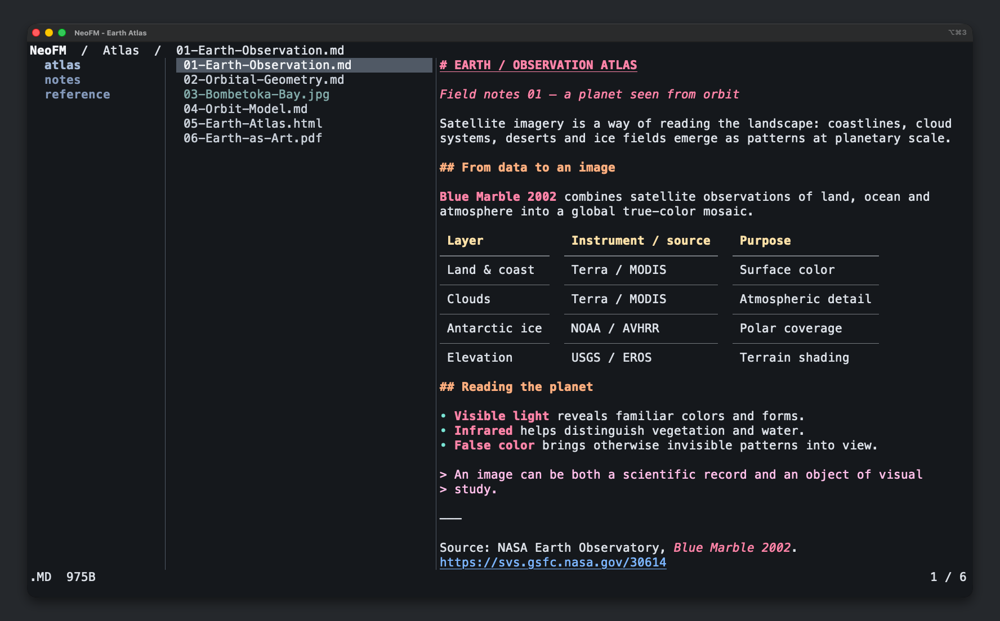
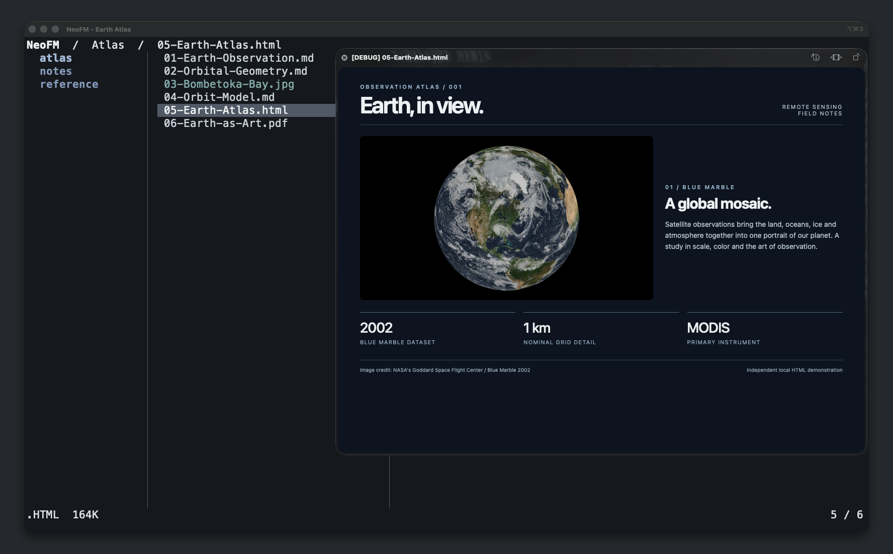
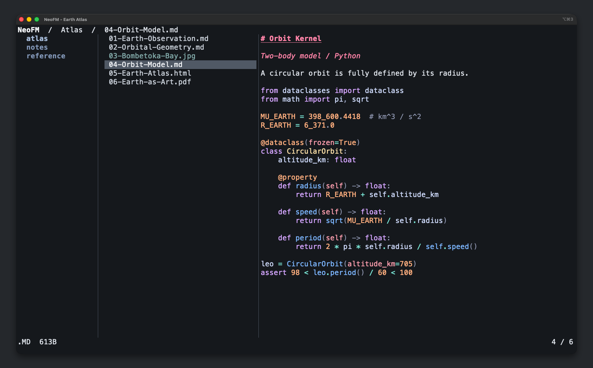

<strong>Современный файловый менеджер для терминала.</strong> Навигация как в Vim. Чтение как в современном просмотрщике документов.

[English](README.md) · [简体中文](README.zh-CN.md) · [繁體中文](README.zh-TW.md) · [日本語](README.ja.md) · [한국어](README.ko.md) · [Français](README.fr.md) · [Deutsch](README.de.md) · [Español](README.es.md) · [Português](README.pt.md) · [Italiano](README.it.md) · **Русский**

  
  
  

---

NeoFM объединяет проверенный файловый менеджер **lf** и самостоятельный Rust-рендерер, извлечённый из Codex TUI. Он обеспечивает богатый предпросмотр документов в лёгкой рабочей среде с управлением с клавиатуры, а большие окна просмотра передаёт инструментам каждой платформы. Без ИИ-сервисов, нового эмулятора терминала или обязательной облачной учётной записи.

*Нажмите Space для просмотра настоящего PDF в Quick Look macOS. NASA, Earth as Art — острова Белчер.*

## Философия дизайна — меньше, но лучше

- **Unix KISS (Keep It Simple, Stupid):** у каждого компонента своя чёткая задача. lf отвечает за навигацию и файловые операции, рендерер — за ограниченный вывод в терминал, нативные инструменты — за большие окна предпросмотра. Сочетать проверенные инструменты вместо их повторной разработки.
- **Вдохновлено [suckless](https://suckless.org/):** небольшие понятные компоненты, мало зависимостей, приоритет клавиатуры и сознательная сдержанность. NeoFM не является официальным проектом suckless.
- **Эстетика через отказ от лишнего:** нет заставки, декоративной панели, ненужных кнопок, встроенного браузера или ИИ-harness. Логотип используется в материалах проекта, а не занимает место в терминале. Добавлять только функции, улучшающие частый рабочий процесс.
- **Единое поведение, нативная реализация:** одинаковая компоновка и клавиши Vim в macOS, Windows и Linux; используются проверенные механизмы предпросмотра и корзины каждой ОС. Локальные файлы остаются локальными.

## Одна компоновка, три платформы

~~~text
┌────────────┬────────────────────────┬────────────────────────────────────────────────┐
│     1      │           2            │                       4                        │
│     ↑      │           →            │                       ◇                        │
└────────────┴────────────────────────┴────────────────────────────────────────────────┘
                 set ratios 1:2:4
~~~

Соотношение по умолчанию — **1:2:4**: слева родительский каталог, в центре текущий каталог и выбор, справа живой предпросмотр. Больше всего места отдано содержимому, без отдельного редактора и постоянной панели инструментов. Скрытые элементы видны по умолчанию; zh переключает их отображение. Компоновка задаётся скриптами запуска без нового терминального UI-фреймворка.

| Содержимое | Живой предпросмотр | Space — большое окно |
|:--|:--|:--|
| Markdown | Заголовки, списки, адаптивные таблицы, CJK, подсветка кода, формулы, Mermaid | Совместимый нативный просмотрщик |
| Изображения | PNG, JPEG, первый кадр GIF, WebP; Sixel или ANSI | Внешний полноразмерный просмотрщик |
| Текст / код | Ограниченный текстовый вывод | Нативный просмотрщик / терминальное чтение |
| PDF, Office, медиа | Метаданные и подсказка предпросмотра | Зависит от поддержки форматов внешним приложением |

## NeoFM в действии

*Предпросмотр Markdown — заголовки, списки и адаптивные таблицы.*

*Математика и Mermaid — дроби и блок-схемы в терминале.*

*HTML Quick Look — локальная HTML-страница в нативном окне.*

*Изображения Sixel — реальная графика в терминале с ограниченным числом пикселей.*

*Код Markdown — подсветка блока Python, а не отдельного исходного файла.*

Реальные снимки macOS; Graphite / Menlo. Источники изображений NASA: [Описание съёмки и источники](docs/gallery.md).

## Рекомендуемая полная конфигурация

| Платформа | Терминал / рабочий стол | Space | Корзина |
|:--|:--|:--|:--|
| macOS ARM64 | [iTerm2](https://iterm2.com/) (Sixel) или Terminal (ANSI) | Встроенный Quick Look | Системная корзина |
| Windows x64 | Современный [Windows Terminal](https://github.com/microsoft/terminal) с Sixel; PowerShell или CMD | Отдельно установленный [QL-Win QuickLook](https://github.com/QL-Win/QuickLook) | Корзина Windows |
| Linux x64 с графикой | [DWM](https://dwm.suckless.org/) / [st](https://st.suckless.org/) или другой терминал; Sixel для растровых изображений | [Dzurkel](https://github.com/EdinUser/dzurkel) | gio / trash-put |
| Linux без графики / SSH | Имеющийся терминал; рекомендуется less | Текст / метаданные | gio / trash-put |

Это рекомендуемые сочетания, а не обязательные среды. Ядро не требует Qt. Без Sixel или в tmux/screen используется ANSI. LFP_IMAGE_BACKEND принимает auto, ansi, sixel, none; принудительно включайте sixel только в совместимом терминале.

## Сборка и запуск

На целевой платформе нужны Go 1.26+ и Rust/Cargo 1.94+, в Windows также инструменты MSVC. Первая сборка загружает зафиксированные зависимости. Это приватный репозиторий разработки, не публичный пакет; клонирование требует авторизованного доступа к GitHub.

### macOS / Linux

~~~sh
git clone https://github.com/lannyyuan/NeoFM.git
cd NeoFM
./scripts/build.sh

# macOS / Apple Silicon
./dist/neofm-macos-arm64/bin/neofm

# Linux / x86_64
./dist/neofm-linux-x64/bin/neofm
~~~

Используйте скрипт запуска, а не lf напрямую. Для локальной команды создайте ссылку на bin/neofm выбранной сборки в ~/.local/bin, не перезаписывая существующий файл. Сохраняйте привычный терминал и оконный менеджер.

**macOS:** дополнительное приложение Quick Look не требуется. Скрипт использует /usr/bin/qlmanage -p; для Sixel рекомендуется iTerm2, системный Terminal может использовать ANSI.

~~~sh
# Optional: prefer Sixel only in a compatible terminal
LFP_IMAGE_BACKEND=auto ./dist/neofm-macos-arm64/bin/neofm
# Inspect the native preview command
command -v qlmanage
~~~

**Linux:** отдельно установите Dzurkel и совместимые зависимости Qt. ANSI работает и в DWM/st без Sixel. Проверьте следующие инструменты, недостающие установите менеджером пакетов дистрибутива. Dzurkel вызывается только в локальном графическом сеансе; обычный SSH использует терминальный режим. При несовместимости Qt настройте отдельную совместимую среду Dzurkel вместо обновления всего рабочего стола.

~~~sh
command -v dzurkel
command -v gio || command -v trash-put
command -v less
command -v xdg-open
~~~

### Windows — полная настройка

Установите Windows Terminal с поддержкой Sixel, [QuickLook](https://github.com/QL-Win/QuickLook) и указанные нативные инструменты сборки. QuickLook — стороннее приложение, не встроенная функция Windows. После установки запустите его один раз в графическом сеансе, затем соберите NeoFM.

~~~powershell
git clone https://github.com/lannyyuan/NeoFM.git
cd NeoFM
powershell -ExecutionPolicy Bypass -File .\scripts\build.ps1
.\dist\NeoFM-win-x64\neofm.cmd
~~~

**Настройка QuickLook:** путь по умолчанию — %LOCALAPPDATA%\Programs\QuickLook\QuickLook.exe. Другие способы установки могут использовать иной путь. В PowerShell задайте и проверьте полный путь к EXE, при необходимости заменив его.

~~~powershell
$env:LFP_QUICKLOOK_EXE = Join-Path $env:LOCALAPPDATA "Programs\QuickLook\QuickLook.exe"
Test-Path -LiteralPath $env:LFP_QUICKLOOK_EXE
# If False, replace the value with the actual full EXE path.
# Optional direct QuickLook test from the repository root (uncomment):
# & $env:LFP_QUICKLOOK_EXE (Resolve-Path ".\dist\NeoFM-win-x64\samples\fixtures-quicklook\01 sample 中文.pdf").Path
# Run from the NeoFM repository root:
.\dist\NeoFM-win-x64\neofm.cmd
~~~

Аналог для CMD:

~~~bat
set "LFP_QUICKLOOK_EXE=%LOCALAPPDATA%\Programs\QuickLook\QuickLook.exe"
if exist "%LFP_QUICKLOOK_EXE%" echo QuickLook OK
where cmd.exe
.\dist\NeoFM-win-x64\neofm.cmd
~~~

**Важно:** всегда запускайте neofm.cmd, а не lf.exe напрямую. Скрипт дополняет System32, ComSpec и PATHEXT в своём процессе, не меняя глобальный PATH. Внутренняя оболочка lf остаётся CMD даже при запуске из PowerShell 5.1 или 7.x. Если Space отмечает файл вместо предпросмотра, возможно, не загружен пользовательский lfrc. При ошибке 'exec: "cmd": executable file not found in %PATH%' перезапустите через скрипт и проверьте System32. Сначала откройте тестовый PDF непосредственно в QuickLook, затем проверьте Space на том же файле. Диагностический журнал и переход на ANSI:

~~~powershell
Get-Content "$env:LOCALAPPDATA\LFpreview\data\lfwin.log" -Tail 30
$env:LFP_IMAGE_BACKEND = "ansi"
.\dist\NeoFM-win-x64\neofm.cmd
~~~

dd использует Windows PowerShell 5.1 и нативный Shell API; проверьте на ненужном файле локального фиксированного диска. Плагины форматов, кодеки и качество изображения терминала не относятся к ядру. Обобщённый путь ещё требует полного регрессионного GUI-теста.

## Клавиши

| Клавиша | Действие | Клавиша | Действие |
|:--|:--|:--|:--|
| `h / j / k / l` | Навигация | `Space` | Quick Look |
| `Enter` | Отметить/снять отметку файла; войти в каталог | `Ctrl+Space` | Переключить отметку |
| `yy` | Копировать | `p` | Вставить |
| `x` | Вырезать | `dd` | Подтвердить и переместить в корзину |
| `o` | Открыть внешним приложением | `zh` | Переключить скрытые элементы |
| `gg / G` | Первый / последний | `/` | Поиск |
| `r` | Переименовать | `q` | Выход |

Отмеченные файлы имеют приоритет, иначе операция выполняется над текущим файлом. dd требует подтверждения и не переходит намеренно к безвозвратному удалению при недоступной нативной корзине.

## Архитектура и проверка

~~~text
                  NeoFM launcher
                        │
                   lf (Go)
             ┌──────────┴───────────┐
             │                      │
    lfpreview (Rust)               Space
       ┌─────┴─────┐                │
   Markdown      Images       Native preview
   Math/Mermaid  Sixel/ANSI   / terminal fallback
~~~

Единое дерево исходников, отдельные скрипты запуска для платформ. См. [архитектуру](docs/architecture.md), [проверку](docs/validation.md) и [происхождение исходников](UPSTREAM.md).

~~~sh
cargo test --locked --manifest-path lf-integration-poc/adapter/Cargo.toml
~~~

Единые нативные сборки Rust Release успешно выполнены на Mac ARM64, Windows x64 и Linux x64; на каждой платформе пройдены четыре базовых теста рендерера, адаптер Mac — 19/19. Предыдущие развёртывания проверяли нативный предпросмотр и корзину. В адаптированном Writer остаются три известных сбоя тестов, производных от upstream. Не заявляются полная совместимость с upstream, полный повтор GUI-тестов, интерактивные вкладки и полноценный PDF/Office или графика высокого разрешения через SSH без графической среды.

## Благодарности и лицензия

Основано на [lf](https://github.com/gokcehan/lf) (MIT) и компонентах [OpenAI Codex](https://github.com/openai/codex) (Apache-2.0). QuickLook и Dzurkel устанавливаются отдельно и не включены. NeoFM — независимый проект. См. [LICENSE](LICENSE), [NOTICE](NOTICE), [лицензию lf](lf-upstream/LICENSE), [UPSTREAM.md](UPSTREAM.md) и [материалы бренда](assets/brand/).

Маленькие инструменты. Ясные файлы. Нативный предпросмотр.

