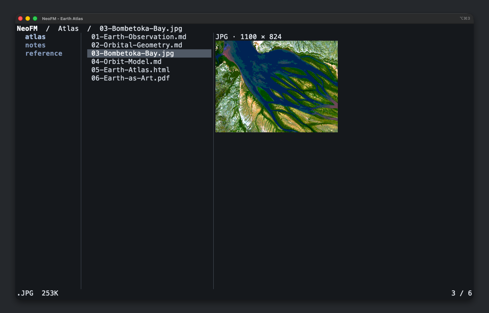

<strong>现代终端文件管理器</strong> 像 Vim 一样导航，像现代文档阅读器一样浏览。

[English](README.md) · **简体中文** · [繁體中文](README.zh-TW.md) · [日本語](README.ja.md) · [한국어](README.ko.md) · [Français](README.fr.md) · [Deutsch](README.de.md) · [Español](README.es.md) · [Português](README.pt.md) · [Italiano](README.it.md) · [Русский](README.ru.md)

  
  
  

---

NeoFM 将成熟的 **lf** 文件管理器与从 Codex TUI 抽取的独立 Rust Renderer 结合，为轻量、键盘优先的终端工作空间提供丰富的文档预览。大窗口预览交给各平台成熟的工具。不依赖 AI 服务，不重新发明终端，不强制使用云端账号。

*按 Space，在 macOS 原生 Quick Look 中浏览真实 PDF。NASA《Earth as Art》— 贝尔彻群岛。*

## 设计思想：少，但更好

- **Unix KISS（Keep It Simple, Stupid）原则：** 每个组件只专注于自己的职责。lf 负责导航和文件操作，Renderer 负责有界终端渲染，原生工具负责大窗口预览。组合成熟部件，而非重复造轮子。
- **受 [suckless](https://suckless.org/) 极简哲学启发：** 小而可理解的组件、少量依赖、键盘优先、有意识的克制。NeoFM 并非 suckless 官方项目。
- **以减法形成品味：** 不做启动画面、装饰性 Dashboard、多余按钮、内嵌浏览器或 AI Harness。Logo 用于项目资料，不占据终端空间。只有显著改善高频工作流的功能才值得加入。
- **统一行为、原生实现：** macOS、Windows、Linux 使用一致布局和 Vim Keymap；预览和回收站复用各系统的成熟能力。本地文件保持本地。

## 一个布局，三个平台

~~~text
┌────────────┬────────────────────────┬────────────────────────────────────────────────┐
│     1      │           2            │                       4                        │
│     ↑      │           →            │                       ◇                        │
└────────────┴────────────────────────┴────────────────────────────────────────────────┘
                 set ratios 1:2:4
~~~

默认比例 **1:2:4**：左侧父目录、中间当前目录与文件选取、右侧实时预览。最大空间留给内容，不新增编辑器或常驻工具栏。默认显示隐藏项，zh 切换。布局由各平台启动配置控制，不引入新的终端 UI 框架。

| 文件 | 侧栏实时预览 | Space 大窗口 |
|:--|:--|:--|
| Markdown | 标题、列表、自适应表格、中日韩文字、代码高亮、公式、Mermaid | 系统支持的原生查看器 |
| 图片 | PNG、JPEG、GIF 首帧、WebP；Sixel 或 ANSI | 外部大图窗口 |
| 文本 / 代码 | 有界文本渲染 | 原生查看器 / 终端阅读器 |
| PDF、Office、媒体 | 元数据与预览提示 | 取决于外部应用的格式支持 |

## NeoFM 实际运行展示

*Markdown 实时预览 — 标题、列表与自适应表格。*

*数学与 Mermaid — 堆叠分式与终端流程图。*

*HTML Quick Look — 原生预览窗口中的本地网页。*

*Sixel 图片 — 真实终端图像，受 Renderer 像素预算限制。*

*Markdown 代码 — Python 围栏代码块语法高亮，非独立源码高亮。*

真实 macOS 截图；Graphite / Menlo。NASA 影像署名详见 [截图说明与素材署名](docs/gallery.md).

## 推荐的全功能组合

| 平台 | Terminal / 桌面 | Space | 回收站 |
|:--|:--|:--|:--|
| macOS ARM64 | [iTerm2](https://iterm2.com/)（Sixel）或系统 Terminal（ANSI） | 系统 Quick Look | 系统 Trash |
| Windows x64 | 支持 Sixel 的新版 [Windows Terminal](https://github.com/microsoft/terminal)；PowerShell 或 CMD | 独立安装 [QL-Win QuickLook](https://github.com/QL-Win/QuickLook) | Windows Recycle Bin |
| Linux x64 桌面 | [DWM](https://dwm.suckless.org/) / [st](https://st.suckless.org/) 或其他终端；位图需要 Sixel 终端 | [Dzurkel](https://github.com/EdinUser/dzurkel) | gio / trash-put |
| Linux Headless / SSH | 现有终端；建议 less | 文本与元数据降级 | gio / trash-put |

这些是推荐组合，而非强制桌面环境。核心不依赖 Qt。不支持 Sixel 的终端或 tmux/screen 使用 ANSI 降级。LFP_IMAGE_BACKEND 可设为 auto、ansi、sixel、none，仅在支持的终端强制 sixel。

## 构建与运行

目标平台需要 Go 1.26+、Rust/Cargo 1.94+；Windows 还需 MSVC 工具链。首次构建下载锁定依赖。目前是私有开发仓库，尚无公共包发行；克隆需要授权的 GitHub 访问权限。

### macOS / Linux

~~~sh
git clone https://github.com/lannyyuan/NeoFM.git
cd NeoFM
./scripts/build.sh

# macOS / Apple Silicon
./dist/neofm-macos-arm64/bin/neofm

# Linux / x86_64
./dist/neofm-linux-x64/bin/neofm
~~~

使用启动器而非裸 lf。若需用户级统一命令，可将对应构建的 bin/neofm 链接到 ~/.local/bin，不覆盖已有入口。保留自己的终端和窗口管理器。

**macOS：** 不需额外 Quick Look 应用。启动器调用 /usr/bin/qlmanage -p；iTerm2 推荐用于 Sixel，系统 Terminal 可以使用 ANSI。

~~~sh
# Optional: prefer Sixel only in a compatible terminal
LFP_IMAGE_BACKEND=auto ./dist/neofm-macos-arm64/bin/neofm
# Inspect the native preview command
command -v qlmanage
~~~

**Linux：** 图形预览需独立安装 Dzurkel 及兼容 Qt 依赖。DWM/st 未支持 Sixel 时仍可用 ANSI。检查以下工具，缺少时用发行版包管理器安装。仅在本地图形会话调用 Dzurkel；普通 SSH 使用终端降级。若 Qt 版本冲突，可单独配置兼容的隔离 Dzurkel Runtime，而不是为 NeoFM 升级整个桌面。

~~~sh
command -v dzurkel
command -v gio || command -v trash-put
command -v less
command -v xdg-open
~~~

### Windows：完整配置方法

安装支持 Sixel 的 Windows Terminal、[QuickLook](https://github.com/QL-Win/QuickLook) 及上述原生编译工具。QuickLook 是 Windows 第三方应用，不是系统自带组件。安装后在当前桌面会话启动一次，再构建 NeoFM。

~~~powershell
git clone https://github.com/lannyyuan/NeoFM.git
cd NeoFM
powershell -ExecutionPolicy Bypass -File .\scripts\build.ps1
.\dist\NeoFM-win-x64\neofm.exe
~~~

**配置 QuickLook：** 启动器默认查找 %LOCALAPPDATA%\Programs\QuickLook\QuickLook.exe。其他安装方式可能使用不同路径。在 PowerShell 中设置并检查完整 EXE 路径，不存在则替换为实际路径：

~~~powershell
$env:LFP_QUICKLOOK_EXE = Join-Path $env:LOCALAPPDATA "Programs\QuickLook\QuickLook.exe"
Test-Path -LiteralPath $env:LFP_QUICKLOOK_EXE
# If False, replace the value with the actual full EXE path.
# Optional direct QuickLook test from the repository root (uncomment):
# & $env:LFP_QUICKLOOK_EXE (Resolve-Path ".\dist\NeoFM-win-x64\samples\fixtures-quicklook\01 sample 中文.pdf").Path
# Run from the NeoFM repository root:
.\dist\NeoFM-win-x64\neofm.exe
~~~

CMD 对应方法：

~~~bat
set "LFP_QUICKLOOK_EXE=%LOCALAPPDATA%\Programs\QuickLook\QuickLook.exe"
if exist "%LFP_QUICKLOOK_EXE%" echo QuickLook OK
where cmd.exe
.\dist\NeoFM-win-x64\neofm.exe
~~~

**注意：** 始终通过 neofm.exe 启动，不直接运行 lf.exe。启动器在自身进程内补齐 System32、ComSpec 和 PATHEXT，不修改全局 PATH。即使从 PowerShell 5.1 或 7.x 启动，lf 内部仍用 CMD。若 Space 变成标记而非预览，可能未加载自定义 lfrc；若出现 'exec: "cmd": executable file not found in %PATH%'，退出后通过启动器重启并检查 System32。先确认 QuickLook 能直接打开测试 PDF，再在 NeoFM 中对同一文件按 Space。诊断日志与 ANSI 降级：

~~~powershell
Get-Content "$env:LOCALAPPDATA\LFpreview\data\lfwin.log" -Tail 30
$env:LFP_IMAGE_BACKEND = "ansi"
.\dist\NeoFM-win-x64\neofm.exe
~~~

dd 通过系统 Windows PowerShell 5.1 与 Shell API 调用回收站；用本地固定磁盘的临时文件确认。QuickLook 格式插件、编解码器及终端像素效果与核心功能分开。通用化路径仍待完整 GUI 回归，详见验收记录。

## 快捷键

| 按键 | 功能 | 按键 | 功能 |
|:--|:--|:--|:--|
| `h / j / k / l` | Vim 导航 | `Space` | Quick Look |
| `Enter` | 标记/取消标记文件；进入目录 | `Ctrl+Space` | 切换标记 |
| `yy` | 复制 | `p` | 粘贴 |
| `x` | 剪切 | `dd` | 确认后移入回收站 |
| `o` | 外部打开 | `zh` | 切换隐藏项 |
| `gg / G` | 首项 / 末项 | `/` | 搜索 |
| `r` | 重命名 | `q` | 退出 |

存在标记时优先操作标记集合，否则操作当前文件。dd 要求确认，回收站不可用时不主动降级为永久删除。

## 架构与验证

~~~text
                  NeoFM launcher
                        │
                   lf (Go)
             ┌──────────┴───────────┐
             │                      │
    neofm-preview (Rust)               Space
       ┌─────┴─────┐                │
   Markdown      Images       Native preview
   Math/Mermaid  Sixel/ANSI   / terminal fallback
~~~

一套共享源码，独立平台启动层。详见[架构](docs/architecture.md)、[验收记录](docs/validation.md)和[上游来源](UPSTREAM.md)。

~~~sh
cargo test --locked --manifest-path lf-integration-poc/adapter/Cargo.toml
~~~

统一 Rust Release 已在 Mac ARM64、Windows x64、Linux x64 原生编译并各通过 4 项 Renderer 冒烟测试；Mac Adapter 19/19。此前部署还验证了实际平台的 Quick Look 和回收站。适配 Writer 保留三个已知上游派生回归失败；不宣称完整上游一致性、完整 GUI 回归、交互式 Sidebar Tabs 或 Headless SSH 下完整 PDF/Office 与高清图形能力。

## 致谢与许可

基于 [lf](https://github.com/gokcehan/lf)（MIT）和 [OpenAI Codex](https://github.com/openai/codex)（Apache-2.0）的抽取组件。QuickLook、Dzurkel 单独安装，不随仓库打包。NeoFM 是独立项目。参见 [LICENSE](LICENSE)、[NOTICE](NOTICE)、[lf 许可](lf-upstream/LICENSE)、[上游来源](UPSTREAM.md) 与 [品牌资源](assets/brand/)。

小工具，清晰的文件，原生的预览。

